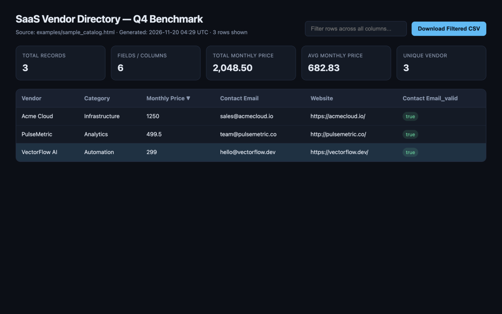

# DataPipe Kit

[](https://github.com/MarkDonish/datapipe-kit/actions/workflows/ci.yml)

-2ea44f)


Zero-dependency Python 3.9+ toolkit for extracting structured data from HTML & JSON-LD, normalizing/deduplicating records, and generating standalone interactive HTML reports.



- **Website & Live Demo**: Once GitHub Pages is enabled on `/docs`, this repo serves both the landing page and the interactive sample report.
- **Zero dependencies**: Runs cleanly on Python 3.9+ standard library (`html.parser`, `urllib`, `csv`, `json`, `re`).

## Quick Start

```bash
python3 -m datapipe pipeline examples/sample_catalog.html \
  --out-dir ./out \
  --required Vendor \
  --dedupe-by Vendor \
  --price-fields "Monthly Price" \
  --email-fields "Contact Email" \
  --url-fields Website \
  --drop-invalid-emails
```

## Run Tests

```bash
python3 -m unittest discover -s tests -v
```
